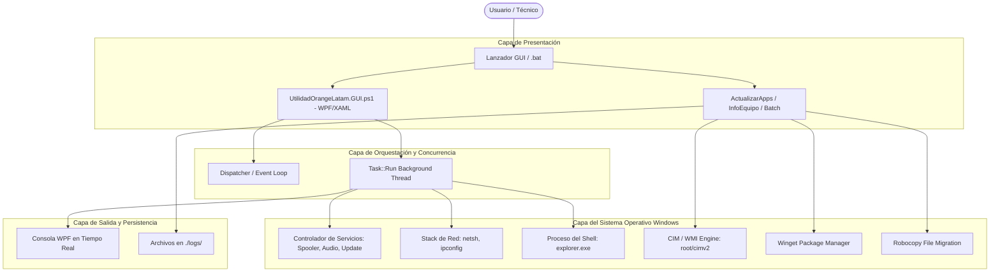

# 05. Arquitectura del Sistema (ARCHITECTURE)

## 1. Principios de Diseño

1. **Native First:** Uso preferente de componentes incluidos en Windows (`WPF`, `PowerShell`, `WMI`, `Batch`, `Robocopy`, `Winget`). No se introducen dependencias de NodeJS, Python o runtimes pesados para mantener el proyecto ligero, portable y ejecutable en cualquier máquina corporativa o doméstica.
2. **Non-Blocking UI (Asincronía):** Ninguna tarea del sistema operativo (reinicio de red, flushing DNS, reinicio de servicios) debe ejecutarse sobre el hilo principal de renderizado de la interfaz gráfica (UI Thread). Se despacha en subprocesos asíncronos y se sincroniza mediante `Dispatcher`.
3. **Fail-Safe & Graceful Degradation:** Si un servicio no existe en una edición específica de Windows (ej. Windows Home vs Pro/Enterprise), la excepción es capturada, registrada en el visor de logs y no interrumpe el resto de los módulos.
4. **Privilege Boundary Enforcement:** Validación explícita de elevación de privilegios de Administrador al inicio del ciclo de vida de cada script.

---

## 2. Mapa y Flujo de Comunicación entre Módulos

---

## 3. Estrategia de Despliegue y Distribución

1. **Modo Portátil (Direct Run):** Los scripts pueden ejecutarse directamente desde una unidad USB o carpeta compartida de red con solo hacer doble clic en los archivos `.bat` o `.ps1`.
2. **Modo Compilado Standalone (.exe):** Los scripts PowerShell pueden compilarse a archivos `.exe` autónomos con `ps2exe`, eliminando la necesidad de cambiar directivas de ejecución (`ExecutionPolicy`) en el equipo destino.
